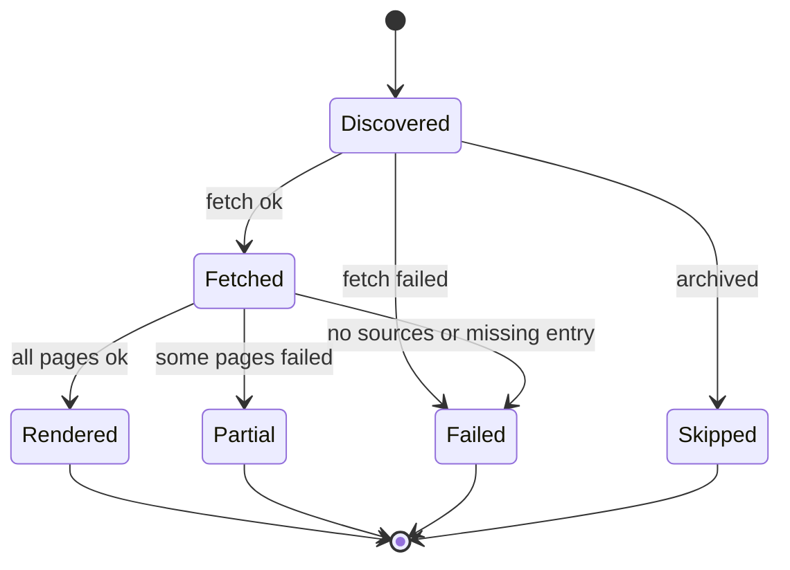

# Data Model: Multi-Repo Documentation Site Builder

**Feature**: `specs/001-multi-repo-docs-site`

Value objects are immutable. Every collection that reaches output is ordered by a documented key so
that output is reproducible.

## Configuration entities

### SiteConfig

The root configuration document, loaded from `site.json`.

| Field | Type | Required | Notes |
| --- | --- | --- | --- |
| `schemaVersion` | integer | yes | Must equal the supported version |
| `site` | SiteSection | yes | Site identity and hosting |
| `organization` | OrganizationSection | yes | Discovery inputs |
| `source` | SourceSection | no | Defaults applied when absent |
| `render` | RenderSection | no | Defaults applied when absent |
| `theme` | ThemeSection | no | Defaults applied when absent |
| `output` | OutputSection | no | Defaults applied when absent |
| `projects` | map of ProjectOverride | no | Keyed by repository name |

Invariants:

- Unknown keys are rejected at every level.
- Every relative path resolves against the directory containing `site.json`.
- `site.basePath` starts and ends with `/` after normalisation.
- `site.baseUrl` has no trailing slash after normalisation.

### SiteSection

`name`, `baseUrl`, `basePath`, `hostname` (optional), `defaultVersionLabel` (default `latest`).

### OrganizationSection

`name`, `propertyName`, `onboardValue`, `tokenEnvVar`, `excludeRepositories` (list).

### SourceSection

`directory` (default `docs`), `defaultBranchOnly` (default true), `entryCandidates` (default
`["index.adoc","README.adoc"]`), `extensions` (default `[".adoc",".asciidoc"]`), `versionPattern`
(default `^v[1-9][0-9]*$`), `excludePatterns` (list of glob patterns).

### RenderSection

`tocLevels` (default `[2,3]`), `safeMode` (default `safe`), `concurrency` (default 4),
`searchExtractLimit` (default 2000), `syntaxHighlighting` (default false).

### ThemeSection

`name` (default `webware`), `defaultAccent` (default `#7e5ae0`), `colorMode` (default `system`),
`defaultColorMode` (default `dark`).

### OutputSection

`directory`, `cacheDirectory`, `reportPath`.

### ProjectOverride

`slug`, `title`, `description`, `accent`, `order`. Every field optional. An override never causes a
project to exist; it only refines a discovered one.

## Discovery entities

### DiscoveredRepository

| Field | Notes |
| --- | --- |
| `name` | Repository name as returned by the API |
| `defaultBranch` | Used for the shallow fetch |
| `archived` | Archived repositories become `skipped` |
| `onboarded` | Whether the property matched the onboard value |
| `slug` | Derived by SlugNormalizer or supplied by override |

Invariants: slug is unique across the project set; a collision is a configuration error.

### Slug

Lowercase, characters outside `[a-z0-9]` collapsed to a single hyphen, leading and trailing hyphens
trimmed, non-empty. `Message_Bus` becomes `message-bus`; a name that collapses to empty is an error.

## Source entities

### FetchedRepository

`repositoryName`, `revision` (resolved commit SHA), `rootPath` (cache directory), `docPath` (absolute
path to the documentation directory or null), `files` (sorted list of paths relative to the
repository root).

### DocVersion

| Field | Notes |
| --- | --- |
| `label` | `vN` or `latest` |
| `numeric` | Integer suffix, or null for `latest` |
| `sourceDirectory` | Absolute path |
| `entryPage` | DocPage for the entry page |
| `pages` | Ordered DocPage list |

Invariants: `numeric` is unique within a project; exactly one version is `latest` and it is the
highest when the project has no numeric versions.

### DocPage

`sourcePath` (relative to the version directory), `publishedPath` (relative to the output root),
`url` (base-path aware), `title`, `sections` (ordered Section list), `status`, `error`.

### Section

`level`, `id`, `title`, `anchorUrl`. Invariant: `id` is non-empty and appears in the rendered page.

### SourceFormat

Enumeration: `Asciidoc`, `Markdown`, `Unsupported`. Today only `Asciidoc` proceeds to rendering. This
type exists so the future Markdown stage has a declared place to act.

## Render entities

### PageContext

`project`, `version`, `page`, `siteConfig`, `theme`, `navigation`, `outdatedBanner`. Passed to
`SiteConverter` and `PageShell` so both render from the same immutable snapshot.

### RenderedPage

`html` (final document), `toc` (Section list), `searchEntry` (page entry for the index), `status`.

### Theme

`name`, `assets` (map of logical name to hashed file name), `tokens` (map of token name to value),
`accent` (resolved per project), `colorMode`.

## Site entities

### Navigation

`projects` (ordered list of ProjectSummary), `currentSlug`, `versions` (ordered list for the current
project), `currentVersion`.

### ProjectSummary

`slug`, `title`, `description`, `latestVersion`, `url`, `status`, `order`.

### Redirect

`from` (output-relative path), `to` (base-path aware URL), `title`. Invariants: `to` resolves to an
existing entry page in the same build.

## Search entities

### SearchIndex

`schemaVersion`, `project` (slug, title), `versions` (ordered list of SearchVersion).

### SearchVersion

`label`, `latest` (boolean), `url`, `pages` (ordered list of SearchPage).

### SearchPage

`url`, `title`, `headings` (ordered list of heading id and title), `text` (normalised, truncated).

### SiteIndex

`schemaVersion`, `projects` (ordered list of slug, title, index location).

## Build entities

### BuildPlan

`projects` (ordered list of PlannedProject), `fullRebuild` (boolean), `themeChanged` (boolean).

### PlannedProject

`project`, `versions`, `pages`, `cacheKey`, `render` (boolean), `reason` (why it is or is not
rendered).

### BuildReport

`schemaVersion`, `generatedBy` (package name and version, never a timestamp), `projects` (ordered
list of ProjectResult), `totals` (counts by status, page counts), `exitCode`.

### ProjectResult

`repository`, `slug`, `status` (`ok`, `partial`, `failed`, `skipped`), `revision`, `versions`,
`pageCount`, `renderedPageCount`, `errors` (list of BuildError), `fetchAttempts`.

### BuildError

`reasonCode`, `version` (nullable), `path` (nullable), `message`, `correctiveAction` (nullable).

### ReasonCode

Closed set: `no-asciidoc-sources`, `missing-entry`, `fetch-failed`, `archived`,
`include-outside-root`, `toc-target-missing`, `invalid-encoding`, `render-failed`, `config-error`,
`discovery-failed`.

## State transitions

Status is terminal within one build. A project that fails does not contribute pages, navigation
entries, or search entries; a `partial` project contributes only its successfully rendered pages.

## Ordering rules

| Collection | Order |
| --- | --- |
| Projects in navigation and on the landing page | Configured `order` ascending, then slug ascending |
| Versions | Numeric descending, `latest` only when no numeric version exists |
| Pages within a version | Published path ascending |
| Sections within a page | Document order |
| Search versions | Numeric descending |
| Search pages | URL ascending |
| Report projects | Slug ascending |
| Report errors | Reason code ascending, then path ascending |

These orders are the contract that makes FR-049 and FR-051 testable.
