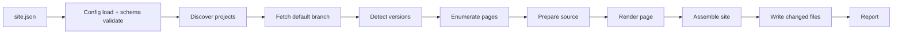

# Implementation Plan: Multi-Repo Documentation Site Builder

**Feature Branch**: `tyrsson-speckit-multi-repo-docs-site`

**Spec**: [spec.md](./spec.md)

**Input**: Feature specification from `specs/001-multi-repo-docs-site/spec.md`

**Note**: This plan is planning-only output. It contains no implementation code. Illustrative JSON,
PHP signatures, CSS token blocks, and shell invocations appear only to fix contracts.

## Summary

Build `webware/asciidoc-php-multi-repo`, a PHP package that turns a set of AsciiDoc trees spread
across an organization's repositories into one static documentation site. The package reads a single
`site.json`, discovers onboarded repositories through an organization custom property, fetches each
repository's default branch, detects published versions by convention (`docs/vN`, or `docs/` as
`latest`), renders every page with a site-owned converter that extends the pinned converter's
`Html5Converter`, and writes a deterministic output tree with redirects, navigation, a shared theme,
and a browser-side search index. It also ships the container stack used for local render, watch, and
preview, and a documented CLI contract that a separate Docker-based GitHub Action will call.

The converter package `webware/asciidoc-php` is not modified. Everything is expressed through its
existing public surface: the `converter` option on `Asciidoc::convert` and `Asciidoc::convertFile`,
document attributes, and the public node and converter classes.

## Technical Context

**Language/Version**: PHP 8.4 or 8.5 (the range the pinned converter declares)

**Primary Dependencies**: `webware/asciidoc-php` (converter, pinned to a compatible constraint),
`ext-json` (report, search index, config), `ext-curl` (GitHub REST property enumeration),
`ext-mbstring` (text normalisation for search extracts)

**Process Dependencies**: `git` (fetch repositories), `docker` and `docker compose` (local stack only,
not required by the CLI)

**Storage**: local filesystem only. A cache directory for incremental builds, an output directory for
the site, a report path. No database, no queue, no daemon.

**Testing**: PHPUnit (already the converter's test runner, so one toolchain), golden-file comparison
for rendered output, recursive hash manifests for determinism, fixture repositories under
`tests/fixtures/` acting as a miniature organization.

**Target Platform**: any platform with PHP 8.4+ and `git`. Primary: Linux container. Secondary:
native Windows and macOS, best effort, no POSIX-only API use.

**Project Type**: single PHP library with a CLI binary, plus a container stack and a JSON Schema.

**Performance Goals**: full build of 10 projects with 2 versions and 12 pages each under 120 seconds
on CI-class hardware; incremental build after a one-page change under 5 seconds; page render cost
dominated by the converter, so the builder parallelises at the project and page level.

**Constraints**: no new runtime binaries beyond PHP and `git`; no Node, no Pagefind, no Sass, no
bundler. CSS and JavaScript are hand-authored and copied verbatim. Output must be byte-identical
across runs. No secret may reach disk, stdout, or the report.

**Scale/Scope**: designed for 10 to 100 repositories, 1 to 10 versions per project, up to a few
thousand pages in aggregate.

## Constitution Check

*GATE: must pass before implementation. Re-checked after Phase 1 design.*

| Principle | How this plan satisfies it | Verdict |
| --- | --- | --- |
| I. Converter Is a Fixed Dependency | All rendering goes through `Asciidoc::convertFile` with a `converter` option pointing at `Render\SiteConverter extends Html5Converter`. No fork, no patch, no vendored copy, no reflection into private members. | PASS |
| II. Configuration Over Hard-Coded Convention | `site.json` supplies organization, property name, onboard value, doc directory, entry candidates, version pattern, slug overrides, base path, theme, limits. Defaults are documented, not compiled in as the only option. | PASS |
| III. Deterministic Output | Build clock attributes are neutralised, all collections are sorted by documented keys, assets are content-hashed, the writer compares bytes before writing, and a hash-manifest test gates CI. | PASS |
| IV. Portability Without POSIX Assumptions | `git` is invoked through `proc_open` with an argument array, never a shell string. Paths go through a `Path` helper that normalises separators and never concatenates with a hard-coded `/` or `\`. No `posix_*`, no `chmod`, no symlink requirement. | PASS |
| V. No New Runtime Binaries | Search is vanilla JavaScript over JSON. Theme is plain CSS. `git` and PHP are the only executables. Container stack is developer-only. | PASS |
| VI. Isolated Failure Domains | Per-project and per-page try/catch with reason codes, `ok`/`partial`/`failed`/`skipped` statuses, exit code 1 for degraded builds, and aggregate pages rebuilt from the set of publishable projects only. | PASS |
| VII. Test-First Against a Fixture Organization | `tests/fixtures/org/` holds the versioned, unversioned, broken, Markdown-only, archived, and mixed-layout cases. Every story's independent test names a fixture. | PASS |
| VIII. Stable External Contract | CLI surface, exit codes, report schema, search index schema, and `site.json` JSON Schema are versioned documents in `specs/001-multi-repo-docs-site/contracts/`. | PASS |

No violations. Complexity Tracking is therefore empty apart from one deliberate deviation recorded
below.

### Deliberate deviation

The builder owns the whole page document and does not use the converter's document shell. This is not
a principle violation (the converter is still the renderer), but it does mean the package must
maintain its own HTML shell. The trade-off is accepted because the converter's shell is a single
document shell, not a site shell: it has no project switcher, no version selector, no sidebar TOC
that is independent of `:toc-placement:`, and it injects clock-derived attributes. Owning the shell is
the only way to satisfy FR-019, FR-021, and FR-050 through the public interface.

## Architecture

### Pipeline



`prepare source` is a deliberate seam. Today it accepts AsciiDoc only: it reads the file, checks the
extension and encoding, normalises line endings, and hands the source and its path to the renderer.
A later Markdown ingestion stage slots in here by detecting the source format and converting to
AsciiDoc before the same render call, with no change to version detection, page enumeration, URL
layout, theming, search, or the writer. See "Future: Markdown ingestion" below.

### Package layout

```
bin/asciidoc-php-multi-repo          CLI entry point, thin: builds argv and calls Cli\Application
config/site.schema.json              published JSON Schema for site.json
resources/
  css/site.css                       hand-authored theme, tokens from the webinertia palette
  css/print.css                      print-only overrides
  js/theme.js                        light/dark toggle with persistence
  js/nav.js                          project switcher and version selector behaviour
  js/search.js                       vanilla search over the project index
  templates/                         PHP templates for the site shell, landing page, 404, redirect
docker/
  Dockerfile                         php:8.4-cli plus git, composer install
  entrypoint.sh                      dispatches render, watch, serve
docker-compose.yml                   render, watch, preview services
src/
  Cli/
    Application.php                  subcommand dispatch, global flag parsing
    Options.php                      immutable parsed options
    Command/DiscoverCommand.php
    Command/FetchCommand.php
    Command/BuildCommand.php
    Command/WatchCommand.php
    Command/ServeCommand.php
    Command/ValidateCommand.php
    Command/CleanCommand.php
    ExitCode.php                     the closed set 0,1,2,3,4
    Output.php                       stderr progress, stdout summary, quiet mode, colour
  Config/
    SiteConfig.php                   immutable value object
    SiteConfigLoader.php             read, decode, validate, resolve paths
    SchemaValidator.php              JSON Schema validation, no new dependency
    ProjectOverride.php
    ThemeConfig.php
    BuildConfig.php
  Discovery/
    ProjectDiscoveryInterface.php
    GitHubPropertyDiscovery.php      REST enumeration via ext-curl, pagination
    ManifestDiscovery.php            offline manifest for tests and air-gapped builds
    DiscoveredRepository.php
    SlugNormalizer.php
    SlugCollisionDetector.php
  Source/
    RepositoryFetcher.php            git init/fetch/checkout into cache, retry, shallow
    FetchedRepository.php            revision, docs path, file list
    VersionDetector.php              ^v[1-9][0-9]*$ plus latest
    DocVersion.php
    PageEnumerator.php
    DocPage.php
    SourcePreparer.php               THE SEAM: format detection and (future) conversion
    SourceFormat.php                 enum: Asciidoc, Markdown, Unsupported
    SourceError.php
  Render/
    SiteConverter.php                extends Html5Converter, overrides convertDocument
    PageRenderer.php                 builds attributes, calls Asciidoc::convertFile
    PageShell.php                    wraps converted body in the site document
    TocExtractor.php                 reads sections from the Document, maps to sidebar
    AttributePolicy.php              deterministic attribute overrides and locks
    LinkRewriter.php                 internal link and asset path adjustment
  Site/
    UrlBuilder.php                   base path aware URL construction
    RedirectWriter.php               meta refresh, canonical, noindex, plain link
    LandingPageBuilder.php
    NavigationBuilder.php            project switcher, version selector, sidebar
    VersionSelectorBuilder.php
    OutdatedBannerBuilder.php
    StaticAssetWriter.php            .nojekyll, CNAME, 404.html, theme assets
    SiteAssembler.php                orchestrates the aggregate pages
  Search/
    SearchIndexBuilder.php           per-project index
    SiteIndexBuilder.php             site-level index of project indexes
    TextExtractor.php                whitespace normalisation, word-boundary truncation
  Theme/
    ThemeResolver.php                tokens, accent merge, asset manifest
    AssetHasher.php                  content-derived asset names
  Build/
    BuildRunner.php                  end-to-end orchestration
    BuildPlan.php                    what to render this run
    IncrementalCache.php             cache keys and stored manifests
    ContentWriter.php                write-only-if-changed, stale removal
    DeterminismGuard.php             rejects clock and path leakage in output
  Report/
    BuildReport.php                  schema-versioned report value object
    ProjectResult.php
    ReasonCode.php                   closed set enum
    ReportWriter.php
  Support/
    Path.php                         separator-safe path joining and normalisation
    ProcessRunner.php                proc_open with argument arrays
    Filesystem.php                   atomic write, recursive scan, hashing
    Json.php                         encode with stable key order and fixed options
    GitIgnoreMatcher.php
```

### Site configuration

`site.json` is the only place where site-specific values live. A real example for the webinertia
fleet:

```json
{
  "$schema": "https://raw.githubusercontent.com/webinertia/asciidoc-php-multi-repo/main/config/site.schema.json",
  "schemaVersion": 1,
  "site": {
    "name": "Webware Documentation",
    "baseUrl": "https://docs.webinertia.net",
    "basePath": "/",
    "hostname": "docs.webinertia.net",
    "defaultVersionLabel": "latest"
  },
  "organization": {
    "name": "webinertia",
    "propertyName": "doc-target",
    "onboardValue": "true",
    "tokenEnvVar": "DOC_DISCOVERY_TOKEN",
    "excludeRepositories": ["docs.webinertia.net", ".github"]
  },
  "source": {
    "directory": "docs",
    "defaultBranchOnly": true,
    "entryCandidates": ["index.adoc", "README.adoc"],
    "extensions": [".adoc", ".asciidoc"],
    "versionPattern": "^v[1-9][0-9]*$",
    "excludePatterns": ["_*.adoc", "**/_*.adoc", "**/drafts/**"]
  },
  "render": {
    "tocLevels": [2, 3],
    "safeMode": "safe",
    "concurrency": 4,
    "searchExtractLimit": 2000,
    "syntaxHighlighting": false
  },
  "theme": {
    "name": "webware",
    "defaultAccent": "#7e5ae0",
    "colorMode": "system",
    "defaultColorMode": "dark"
  },
  "output": {
    "directory": "build/site",
    "cacheDirectory": ".cache/multi-repo",
    "reportPath": "build/report.json"
  },
  "projects": {
    "message-bus": {
      "title": "Message Bus",
      "description": "Message bus abstractions, transports, and handlers for PHP.",
      "accent": "#7e5ae0",
      "order": 10
    },
    "messagebus-event": {
      "title": "Message Bus Event",
      "description": "Event-driven messaging primitives built on message-bus.",
      "accent": "#05a578",
      "order": 20
    }
  }
}
```

Rules the loader enforces:

- `schemaVersion` must equal the version the package supports; a newer value is a configuration error.
- Relative paths (`output.directory`, `output.cacheDirectory`, `output.reportPath`) resolve against the
  directory containing `site.json`, never against the process working directory (FR-067).
- `theme.name` selects a built-in token set; the only built-in set in this feature is `webware`.
- `projects` entries are optional overrides. A discovered repository with no override still appears.
- Unknown top-level keys are rejected so a typo cannot silently disable a feature.

### CLI surface

```
asciidoc-php-multi-repo <command> [options]

Commands:
  discover    List onboarded repositories and resolved slugs. Writes nothing to the output.
  fetch       Fetch documentation sources into the cache. No rendering.
  build       discover + fetch + render + assemble + write + report. The Action calls this.
  watch       Rebuild affected projects on change and serve the site.
  serve       Serve an already built output directory.
  validate    Report per-repository buildability without writing site output.
  clean       Remove the cache directory and, with --output, the output directory.

Global options:
  -c, --config <path>        site.json path. Default: ./site.json
  -o, --out <dir>            Override output.directory
      --cache <dir>          Override output.cacheDirectory
      --report <path>        Write the JSON report to this path
      --concurrency <n>      Override render.concurrency
      --project <name>       Repeatable. Limit to these slugs or repository names.
      --ref <revision>       Repeatable, name=ref. Override the ref for one repository.
      --manifest <path>      Read discovery from a manifest instead of the organization.
      --full                 Ignore cached state and rebuild everything.
      --base-path <path>     Override site.basePath.
      --port <n>             Port for watch and serve. Default 8080.
  -q, --quiet                Errors only.
  -v, --verbose              Per-page detail.
  -t, --timings              Per-phase timings on stderr.
      --no-color             Disable ANSI colour.
  -h, --help
      --version
```

Exit codes are the closed set in `Cli\ExitCode`: `0` all `ok` or `skipped`, `1` any `partial` or
`failed`, `2` configuration error, `3` discovery failure, `4` unexpected internal error. The full
contract lives in `contracts/cli.md`.

Every command is non-interactive: no prompt, no terminal requirement, no read from standard input
(FR-068).

### Custom converter strategy

The package does not touch the converter. It supplies an instance through the existing option:

```php
$html = Asciidoc::convertFile($path, [
    'backend'       => 'html5',
    'safe'          => $config->safeMode(),
    'header_footer' => true,
    'base_dir'      => $versionDir,
    'attributes'    => $attributes,
    'converter'     => new SiteConverter($pageContext),
]);
```

`Render\SiteConverter extends Webware\AsciidocPhp\Converter\Html5Converter`. It overrides only what
the site shell requires:

- `convertDocument()` returns the inner article markup only (a fragment), so `PageShell` can place it
  inside the site document. The default `Html5Converter::convertDocument` builds `<html>`, `<head>`,
  and the converter's own stylesheet link or inline embed; that is exactly what the site must replace.
- `renderStylesheet()` returns an empty string, so the converter's default `asciidoctor.css` is never
  linked or embedded. The site stylesheet is the only stylesheet. This is belt and braces alongside
  passing `:stylesheet!:` and `:noembed:`.
- Section conversion is left untouched, so `<div class="sectN"><hN id="...">` markup and ids stay
  stable and are what the sidebar TOC and search anchors point at.
- No method is overridden for TOC: the builder reads `$document->getSections()` through
  `TocExtractor` and renders the sidebar itself, which decouples the sidebar from `:toc-placement:`
  and keeps the markup under the site's control.

`AttributePolicy` passes the following attributes on every page:

- `stylesheet!` and `noembed` so no converter stylesheet is emitted.
- `linkcss!` because the site links its own stylesheet in the shell, not through the converter.
- `toc!` because the sidebar is site-owned.
- `icons` off, and `source-highlighter!` unless syntax highlighting is enabled, because a
  highlighter would introduce an external script.
- `docdate`, `doctime`, `docdatetime`, `localdate`, `localtime`, `localdatetime` set to fixed empty
  values so clock-derived built-ins cannot leak into output (FR-050). Caller attributes are applied
  after built-ins, so the override wins.
- `docinfo!` so no docinfo file is pulled in from the source tree.

The converter's public node API is used for structure only: `AbstractNode::convert()` for fragments,
`AbstractBlock::getBlocks()` and `getSections()`, and `Section::getId()`, `getLevel()`, `getTitle()`.

### Theme and asset pipeline

Hand-authored CSS with custom properties, no build step. Tokens are taken from
`webinertia/default-theme`'s palette and re-expressed for a documentation layout; Bootstrap is not
pulled in.

```css
:root {
  --color-primary: #7e5ae0;
  --color-secondary: #05a578;
  --color-accent: var(--color-primary);
  --color-link: #6a49c9;
  --color-link-hover: #543a9e;
  --surface-page: #ffffff;
  --surface-raised: #f6f5fa;
  --text-body: #1e1b26;
  --text-muted: #55506b;
}

[data-theme="dark"] {
  --color-link: #b29cec;
  --color-link-hover: #cbbdf3;
  --surface-page: #16131c;
  --surface-raised: #1f1b28;
  --text-body: #e8e5f0;
  --text-muted: #a8a2ba;
}
```

Contrast is a gate, not a hope: the light-mode link colour is darkened to `#6a49c9` and the light-mode
secondary text to `#048460` so normal text clears 4.5:1. A test computes contrast for every
foreground/background pair declared in the token set and fails below 4.5:1 for text.

Asset pipeline:

1. `ThemeResolver` reads the token set, merges the site default accent, and merges per-project accents
   into a per-project `accent.css` containing one rule (`--color-accent`).
2. `AssetHasher` computes a short hash of each asset's bytes and produces names such as
   `site.3f9c1a.css`.
3. `StaticAssetWriter` copies assets once per build, writes them only if the bytes differ, and removes
   hashed names that no longer appear.
4. The shell references only hashed local paths built through `UrlBuilder`, so a base path is
   respected and no external origin is referenced (FR-023, FR-034, SC-007).

### Page shell

`PageShell` renders one document per page:

```html
<!DOCTYPE html>
<html lang="en" data-theme="dark">
<head>
  <meta charset="utf-8">
  <meta name="viewport" content="width=device-width, initial-scale=1">
  <title>Page Title | Project Title | Site Name</title>
  <link rel="canonical" href="...">
  <link rel="stylesheet" href="/assets/site.<hash>.css">
  <link rel="stylesheet" href="/assets/accent.<hash>.css">
</head>
<body>
  <a class="skip-link" href="#main">Skip to content</a>
  <header>site name, project switcher, version selector, theme toggle, search control</header>
  <div class="layout">
    <nav class="sidebar" aria-label="On this page">sections</nav>
    <main id="main">converted fragment</main>
  </div>
  <footer>source link, project, version</footer>
  <script src="/assets/theme.<hash>.js" defer></script>
  <script src="/assets/nav.<hash>.js" defer></script>
  <script src="/assets/search.<hash>.js" defer></script>
</body>
</html>
```

The shell is a PHP template with escaping applied to every interpolation. No timestamp, no build id,
no absolute path, no environment value.

### URL layout and redirects

| Source | Published path |
| --- | --- |
| `docs/v2/index.adoc` | `<slug>/v2/index.html` |
| `docs/v2/api-reference/message-bus.adoc` | `<slug>/v2/api-reference/message-bus.html` |
| `docs/index.adoc` (unversioned) | `<slug>/latest/index.html` |
| project root | `<slug>/index.html` (redirect) |
| site root | `index.html` (landing page) |

`RedirectWriter` produces a redirect document that needs neither JavaScript nor server rules:

```html
<!DOCTYPE html>
<html lang="en">
<head>
  <meta charset="utf-8">
  <title>Redirecting to v2</title>
  <link rel="canonical" href="https://docs.webinertia.net/message-bus/v2/">
  <meta name="robots" content="noindex">
  <meta http-equiv="refresh" content="0; url=/message-bus/v2/">
</head>
<body>
  <p>Redirecting to <a href="/message-bus/v2/">/message-bus/v2/</a>.</p>
</body>
</html>
```

The target is the numerically highest `vN`, or the `latest` label when there is no numeric version.
The same document shape is used for a version root that is not the entry page only if a version has no
`index.adoc` or `README.adoc`, which is already a `missing-entry` failure, so in practice redirects are
only written at project roots and at the site root when `basePath` is not `/`.

### Search index format

Per project at `<slug>/search-index.json`:

```json
{
  "schemaVersion": 1,
  "project": { "slug": "message-bus", "title": "Message Bus" },
  "versions": [
    {
      "label": "v2",
      "latest": true,
      "url": "/message-bus/v2/",
      "pages": [
        {
          "url": "/message-bus/v2/api-reference/message-bus.html",
          "title": "Message Bus API Reference",
          "headings": [
            { "id": "sending-a-message", "title": "Sending a message", "level": 2 }
          ],
          "text": "Normalised plain text, truncated at a word boundary."
        }
      ]
    }
  ]
}
```

Site index at `search-index.json` in the output root:

```json
{
  "schemaVersion": 1,
  "projects": [
    { "slug": "message-bus", "title": "Message Bus", "index": "/message-bus/search-index.json" }
  ]
}
```

Rules: keys are emitted in the order shown by `Support\Json`; versions sort numerically descending;
pages sort by URL; headings sort by document order; `text` is whitespace-normalised and truncated at
the configured limit on a word boundary; no field is ever absent (empty arrays instead of `null`).

The client loads only the site index plus the current project's index, which keeps a first search
under 1 second on a 2,000-page site. Ranking is field-weighted: title match 3, heading match 2, body
match 1, with ties broken by page URL so ordering is stable.

### Incremental build

Cache key per project is the SHA-256 of a canonical JSON document containing:

- the resolved configuration slice that affects that project (slug, title, description, accent,
  order, toc levels, extract limit, base path, base URL, theme name, converter version constraint);
- the repository name and the resolved revision;
- the relative path and content hash of every published source file;
- the content hash of every theme and script asset;
- the package's own output format version.

A project whose key is unchanged is skipped and its output is left in place. Aggregate pages are
rebuilt whenever the set of publishable projects, any project's metadata, or the theme changes.
`ContentWriter` compares bytes before writing, so an unchanged project rewrites nothing even when it
is re-rendered. Full builds ignore the cache and, after writing, remove any output file that is not in
the current plan.

### Container stack

`docker-compose.yml` in this repository, independent of the converter repository's stack:

| Service | Command | Purpose |
| --- | --- | --- |
| `render` | `build --config /site/site.json` | One-shot full or incremental build into the mounted output directory |
| `watch` | `watch --config /site/site.json --port 8080` | Rebuild changed projects, serve the site, expose 8080 |
| `preview` | `serve --config /site/site.json --port 8080` | Serve an already built tree without rebuilding |

`docker/Dockerfile` builds from `php:8.4-cli`, installs `git` and the required extensions, copies
`composer.json` and `composer.lock`, runs `composer install --no-dev --no-interaction`, then copies
the source. `docker/entrypoint.sh` dispatches on the first argument. The preview server resolves
`/slug/` to the redirect `index.html` and clean paths to `index.html`, so redirect and clean-URL
behaviour can be exercised locally (FR-073).

### Future: Markdown ingestion

Version 1 accepts AsciiDoc only. A repository whose documentation tree contains no `.adoc` or
`.asciidoc` source fails with reason `no-asciidoc-sources` and is excluded, as specified.

Planned follow-on work adds a Markdown to AsciiDoc conversion stage so an onboarded repository can
keep its existing Markdown and have it converted during the build. The design already reserves the
seam: `Source\SourcePreparer` is the single place where a source file is read and turned into AsciiDoc
input for the renderer. `Source\SourceFormat` already distinguishes `Asciidoc`, `Markdown`, and
`Unsupported`. Adding the converter means extending `SourcePreparer` to detect format by extension
and content, convert Markdown to AsciiDoc, and return the converted source plus its origin. Nothing
else in the pipeline changes: version detection, page enumeration, URL layout, the converter
invocation, theming, search, the writer, the report, and the CLI contract all stay as they are. The
only visible changes will be a new configuration switch for accepted formats, a new reason code for
conversion failures, and a report field naming the detected source format.

No task in this plan implements it, and no requirement in the spec depends on it.

## Project Structure

### Documentation (this feature)

```
specs/001-multi-repo-docs-site/
  spec.md                 feature specification
  plan.md                 this file
  research.md             decisions resolved during planning
  data-model.md           entities, value objects, invariants
  quickstart.md           how to run a build, watch, and preview
  contracts/
    cli.md                command surface, flags, exit codes
    report.schema.json    build report schema
    search-index.schema.json  search index schema
    site.schema.json      site.json JSON Schema
  checklists/
    requirements.md       specification quality checklist
  tasks.md                ordered implementation tasks
```

### Source (repository root)

```
bin/
config/
docker/
resources/
src/
tests/
  fixtures/org/          miniature organization for every story's independent test
  Golden/                expected rendered output for one project
  Determinism/           hash manifest helpers
composer.json
docker-compose.yml
README.md
```

## Phase 0 research outcomes

Full detail in `research.md`. Summary of the decisions that shape the plan:

1. **Owning the page shell** is required, because the converter's shell has no site chrome and emits
   clock attributes. `convertDocument` is overridable because `ConverterInterface::convert()` is
   public and `Html5Converter` is not final.
2. **Suppressing the default stylesheet** is achievable three ways; the plan uses all three
   (`stylesheet!`, `noembed`, and an empty `renderStylesheet`) so a converter change cannot silently
   reintroduce an external or duplicate stylesheet.
3. **Determinism** needs attribute overrides for `docdate`, `doctime`, `docdatetime`, `localdate`,
   `localtime`, `localdatetime`, because `Document::initBuiltinAttributes()` derives them from the
   clock. Caller attributes overlay built-ins, so overriding is enough; `DeterminismGuard` additionally
   scans output for clock-shaped and path-shaped strings as a regression net.
4. **Redirects** use meta refresh plus canonical plus `noindex` plus a plain link, because GitHub Pages
   cannot serve server-side redirects from a static branch.
5. **Search** is JSON plus vanilla JavaScript, because any library or index binary would violate the
   no-new-binaries principle and add an external origin.
6. **Fetching** uses `git` with `--depth 1` on the default branch into a cache directory, then reads
   the working tree. No GitHub archive API dependency, so a third party with only `git` can run it.
7. **Discovery** uses the GitHub REST custom property values endpoint through `ext-curl` with a
   token from the environment, paginated. No dependency on the `gh` CLI, which the action image would
   then have to ship.
8. **Incrementality** keys on configuration plus revision plus source hashes plus theme hashes, so a
   changed page invalidates its project, a changed theme invalidates everything, and an unchanged
   revision with changed local bytes still rebuilds.

## Complexity Tracking

| Deviation | Why needed | Simpler alternative rejected because |
| --- | --- | --- |
| Site owns the HTML document shell instead of the converter | The converter's shell cannot express project switcher, version selector, site-owned sidebar, or clock-free output | Using `header_footer` and post-processing the converter's shell would require parsing HTML to inject chrome, which is more fragile than rendering a template |
| Content-hashed asset names | Cache invalidation without a build id, while keeping output deterministic | A fixed asset name plus a query string would either be non-deterministic or defeat caching on GitHub Pages, which ignores query strings for caching |

## Confirmed decisions

These are settled decisions, accepted by the user on 2026-10-31. Each line states the decision and the
alternative that was rejected.

1. Search extract limit is 2,000 characters per page, truncated at a word boundary; rejected: no
   truncation, which inflates the index for long API pages.
2. One search index per project covering all versions, plus a site index of projects; rejected: one
   index per project per version, which multiplies requests and duplicates text.
3. Default concurrency is 4 parallel page renders per project; rejected: unbounded parallelism, which
   risks memory pressure in a 1 GB container.
4. `site.json` lives at the root of the site repository and the schema is published at
   `config/site.schema.json` in this package, referenced by a raw GitHub URL; rejected: hosting the
   schema on the docs site, which couples schema availability to a build.
5. Creating the `doc-target` organization property is a documented setup step owned by the operator,
   not something the builder does; rejected: having the builder create the property, which would need
   admin scope and mutate organization state.
6. Discovery uses the GitHub REST custom property values endpoint with a fine-grained PAT from the
   environment; rejected: shelling out to `gh`, which adds a binary to the action image.
7. The site repository's nightly, dispatch, and `repository_dispatch` workflows are specified in the
   follow-on action and site specifications; this spec only guarantees the CLI they call; rejected:
   putting the workflow YAML in this spec, which mixes builder scope with deployment scope.
8. Migrating `message-bus` and `messagebus-event` Markdown docs to AsciiDoc is tracked as separate
   PRs in those repositories, referenced from the task list but not performed here; rejected:
   migrating inside this repository, which cannot touch another repository's tree.
9. Markdown ingestion is follow-on work behind the `SourcePreparer` seam; rejected: shipping Markdown
   support in v1, which the user explicitly deferred.
10. Numeric version ordering compares integers, so `v10` outranks `v2`; rejected: lexicographic
    ordering, which would rank `v10` below `v2`.
